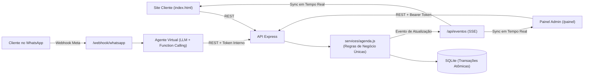

# Barber AI Booking Platform — Intelligent Scheduling Ecosystem

[](https://nodejs.org/)
[](https://expressjs.com/)
[](https://developers.facebook.com/)
[](https://openai.com/)
[-blueviolet.svg)](#arquitetura-do-sistema)
[-003B57.svg?logo=sqlite)](https://nodejs.org/api/sqlite.html)

Ecossistema Full-Stack de agendamento em tempo real com **Agente de IA no WhatsApp** (Secretária Virtual autônoma), **Aplicação Web Mobile-First** e **Painel Administrativo de Gestão**, operando sobre uma **única API REST** e um **banco de dados transacional atômico**.

Projetado com arquitetura *passwordless*: o **número de WhatsApp validado do cliente funciona como sua identidade global**, eliminando fricção de cadastro e autenticação.

---

## 🏗️ Arquitetura do Sistema



### ⚡ Destaques de Engenharia e Concorrência

* **Sincronização Bidirecional em Tempo Real via SSE**: Qualquer alteração na grade (feita no site, pelo WhatsApp ou no painel) dispara um evento **Server-Sent Events**. O site e o painel admin atualizam a disponibilidade dos barbeiros instantaneamente sem recarregar a página.
* **Prevenção Concorrente de Double-Booking**: Regras unificadas em `services/agenda.js` com transações seriais que impedem marcações duplicadas no mesmo horário, mesmo que múltiplos clientes ou a IA tentem agendar simultaneamente.
* **Agente de IA Autônomo com Function Calling**:
  * O bot processa linguagem natural ("*muda meu corte de quinta para sexta às 10h*"), consulta a disponibilidade ao vivo via ferramentas (*tool calling*) e executa a remarcação de forma atômica.
  * O WhatsApp do remetente é injetado pelo backend com validação criptográfica HMAC-SHA256 (`X-Hub-Signature-256`), garantindo que nenhum usuário altere agendamentos de terceiros.
* **Node.js 22 com Driver SQLite Embutido**: Utilização do módulo nativo `node:sqlite`, eliminando dependências externas com compilação em C++ (`node-gyp`) e garantindo portabilidade imediata.

---

## 📁 Estrutura do Projeto

Barber-AI-Booking-Platform/ ├── public/ │ ├── index.html # Interface do cliente (Mobile-First) │ ├── painel.html # Dashboard administrativo │ ├── css/ # Estilização com Dark Neon e Glassmorphism │ ├── js/ # Camada cliente e listeners de SSE │ └── assets/ # Imagens, branding e identidade visual │ ├── src/ │ ├── server.js # Servidor Express, middlewares e CORS │ ├── config.js # Validação de variáveis de ambiente │ ├── ai/ # Agente LLM, prompt engineering e tools │ ├── db/ # Schema DDL, migrações e seed │ ├── services/ # Motor de agendamento (Single Source of Truth) │ ├── routes/ # Rotas públicas, administrativas e webhooks │ └── lib/ # Utilitários de tempo, telefone e eventos SSE │ ├── package.json └── .env.example


---

## 📡 Endpoints da API REST

### 🌐 Rotas Públicas (Website)
| Método | Endpoint | Descrição |
| :---: | :--- | :--- |
| `GET` | `/api/servicos` | Lista serviços cadastrados, duração e preços |
| `GET` | `/api/barbeiros` | Lista profissionais e dias de expediente |
| `GET` | `/api/horarios-disponiveis` | Grade de horários com checagem de vagas livres |
| `POST`| `/api/agendamentos` | Criação de novo agendamento com validação |
| `GET` | `/api/eventos` | Stream SSE de atualizações da agenda |

### 🤖 Rotas Internas (Agente de IA) — `X-Internal-Token`
| Método | Endpoint | Descrição |
| :---: | :--- | :--- |
| `GET` | `/api/interno/clientes/:whatsapp` | Perfil do cliente e histórico de agendamentos |
| `POST`| `/api/interno/agendamentos` | Agendamento via assistente de voz/texto |
| `PATCH`| `/api/interno/agendamentos/:id/remarcar`| Remarcação de horário com validação de vagas |
| `PATCH`| `/api/interno/agendamentos/:id/cancelar`| Cancelamento de horário e liberação da vaga |

### 🛡️ Rotas Administrativas — `Authorization: Bearer <ADMIN_TOKEN>`
| Método | Endpoint | Descrição |
| :---: | :--- | :--- |
| `GET` | `/admin/relatorio-diario` | Faturamento, atendimentos concluídos e métricas |
| `GET` | `/admin/relatorio-diario?formato=csv` | Exportação de planilha formatada em CSV (Excel UTF-8) |
| `PATCH`| `/admin/agendamentos/:id/status` | Marcação de status (concluído, cancelado, falta) |

---

## 🚀 Como Executar o Projeto

### Pré-requisitos
* **Node.js 22.13+** instalado.

### Passo a Passo

```bash
# 1. Clone o repositório
git clone https://github.com/caiodantass/Barber-AI-Booking-Platform.git
cd Barber-AI-Booking-Platform

# 2. Instale as dependências
npm install

# 3. Configure as variáveis de ambiente
cp .env.example .env

# 4. Popule o banco de dados com dados iniciais
npm run seed

# 5. Inicie o servidor de desenvolvimento
npm run dev
```

Acesse as interfaces:

Site do Cliente: [http://localhost:3000](http://localhost:3000)
Painel Administrativo: [http://localhost:3000](http://localhost:3000/painel)

---

🧪 Teste Rápido do Agente de IA (Sem Webhook da Meta)

Você pode simular conversas reais da IA enviando requisições locais:

```bash
curl -X POST http://localhost:3000/webhook/simular \
  -H "Content-Type: application/json" \
  -d '{"whatsapp":"5583988887777","texto":"Quero cortar cabelo amanhã de manhã","nome":"João"}'
```

--- 

## 👨‍💻 Autor

**Caio Dantas**  
* Engenheiro de Software / Desenvolvedor de Firmware  
* GitHub: [@caiodantass](https://github.com/caiodantass)  
* LinkedIn: [linkedin.com/in/caiodantass](https://www.linkedin.com/in/caio-l%C3%ADvio/)
